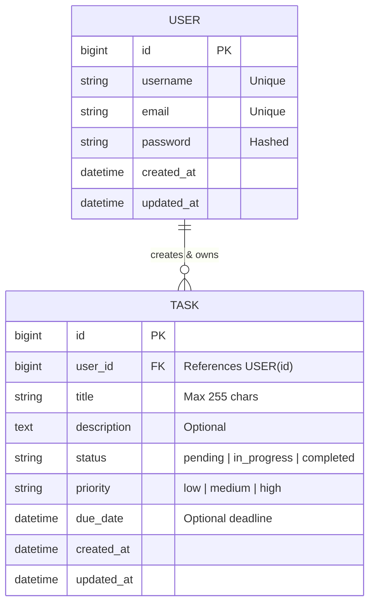

# TaskFlow — Task Management REST API

[](https://www.python.org/)
[](https://www.djangoproject.com/)
[](https://www.django-rest-framework.org/)
[](https://www.postgresql.org/)
[](https://django-rest-framework-simplejwt.readthedocs.io/)
[](http://localhost:8000/api/docs/)
[](.github/workflows/ci.yml)

TaskFlow is a production-grade backend task management REST API developed with **Python**, **Django**, **Django REST Framework (DRF)**, and **PostgreSQL**. It empowers users to securely create, organize, prioritize, track, and manage daily tasks with JWT authentication, user data isolation, full-text search, multi-field filtering, pagination, and interactive OpenAPI 3 (Swagger) documentation.

---

## Table of Contents

- [1. Key Features](#1-key-features)
- [2. Technology Stack](#2-technology-stack)
- [3. Architecture & Directory Structure](#3-architecture--directory-structure)
- [4. Database Design](#4-database-design)
- [5. Getting Started](#5-getting-started)
  - [Prerequisites](#prerequisites)
  - [Option A: Local Development Setup](#option-a-local-development-setup)
  - [Option B: Docker Compose Setup (PostgreSQL + API)](#option-b-docker-compose-setup-postgresql--api)
- [6. Seeding Demo Data](#6-seeding-demo-data)
- [7. API Documentation (Swagger & ReDoc)](#7-api-documentation-swagger--redoc)
- [8. API Endpoints Reference & Examples](#8-api-endpoints-reference--examples)
  - [Authentication Endpoints](#authentication-endpoints)
  - [Task Endpoints](#task-endpoints)
- [9. Testing](#9-testing)
- [10. Environment Variables](#10-environment-variables)

---

## 1. Key Features

- **Robust Authentication & Authorization**:
  - Secure user registration with validation (unique email, password confirmation, Django password strength validators).
  - Flexible login accepting either **Username** or **Email** alongside password.
  - JWT tokens (**Access** and **Refresh**) powered by `djangorestframework-simplejwt` with token rotation and blacklisting.
  - User profile endpoint with live aggregated task statistics.
- **Strict Multi-Tenant User Isolation**:
  - Users can strictly view, search, modify, or delete only their own tasks.
  - Foreign key relations and queryset filtering prevent cross-tenant data leakage.
- **Complete Task CRUD**:
  - Create tasks with title, description, priority, status, and deadline (`due_date`).
  - Retrieve single task details or paginated task lists.
  - Full updates (`PUT`) and partial updates (`PATCH`, e.g. marking as completed).
  - Task deletion (`DELETE`) returning `204 No Content`.
- **Advanced Filtering, Search, and Sorting**:
  - Filter by **Status**: `pending`, `in_progress`, `completed`.
  - Filter by **Priority**: `low`, `medium`, `high`.
  - Filter by **Due Date**: exact, before, after, or overdue.
  - Full-text search across task **title** and **description** (`?search=assignment`).
  - Sorting by creation date, deadline, priority, or status (`?ordering=-created_at`).
  - Configurable page size pagination (`?page=1&page_size=10`).
- **Standardized Error Handling**:
  - Uniform JSON error formats with explicit HTTP status codes (`200`, `201`, `204`, `400`, `401`, `403`, `404`).
- **Interactive Documentation**:
  - Auto-generated OpenAPI 3.0 schema, Swagger UI (`/api/docs/`), and ReDoc (`/api/redoc/`) via `drf-spectacular`.

---

## 2. Technology Stack

| Component | Technology | Version | Purpose |
|---|---|---|---|
| **Language** | Python | 3.12+ | Core programming language |
| **Backend Framework** | Django | 5.0+ | Web framework and ORM |
| **API Framework** | Django REST Framework | 3.14+ | Serialization, viewsets, authentication |
| **Database** | PostgreSQL / SQLite | 16 / 3.x | Primary relational store (auto-fallback to SQLite in local dev) |
| **Authentication** | Simple JWT | 5.3+ | JSON Web Token issuance and verification |
| **Filtering** | django-filter | 23.5+ | Declarative query filtering |
| **Documentation** | drf-spectacular | 0.27+ | OpenAPI 3.0 schema, Swagger UI, and ReDoc |
| **WSGI Server** | Gunicorn | 21.2+ | Production WSGI application server |
| **Testing** | Django TestCase / Pytest | Latest | Automated unit and integration test suite |
| **Containerization** | Docker & Docker Compose | Latest | Multi-container reproducible deployment |

---

## 3. Architecture & Directory Structure

```text
TaskFlow/
├── apps/
│   ├── authentication/           # User authentication and custom User model
│   │   ├── migrations/           # Database migration files
│   │   ├── tests/                # Unit and integration tests for auth
│   │   │   ├── __init__.py
│   │   │   └── test_auth.py
│   │   ├── admin.py              # User admin configuration
│   │   ├── apps.py               # App configuration
│   │   ├── backends.py           # EmailOrUsername authentication backend
│   │   ├── models.py             # Custom User model (extends AbstractUser)
│   │   ├── serializers.py        # Register, Login, UserProfile serializers
│   │   ├── urls.py               # /api/auth/ routing
│   │   └── views.py              # RegisterView, LoginView, ProfileView
│   └── tasks/                    # Task management domain
│       ├── management/commands/  # Custom commands (seed_demo_data)
│       ├── migrations/           # Database migration files
│       ├── tests/                # Unit and integration tests for tasks
│       │   ├── __init__.py
│       │   └── test_tasks.py
│       ├── admin.py              # Task admin configuration
│       ├── apps.py               # App configuration
│       ├── filters.py            # TaskFilter (status, priority, date ranges)
│       ├── models.py             # Task model with status & priority choices
│       ├── permissions.py        # IsOwner permission class
│       ├── serializers.py        # TaskSerializer with display labels
│       ├── urls.py               # /api/tasks/ router endpoints
│       └── views.py              # TaskViewSet with CRUD and summary action
├── core/                         # Shared utilities
│   ├── exceptions.py             # Standardized API exception handler
│   └── pagination.py             # StandardResultsSetPagination
├── taskflow/                     # Project configuration
│   ├── asgi.py
│   ├── settings.py               # Settings (JWT, DB, Spectacular, CORS)
│   ├── urls.py                   # Root URL dispatcher and Swagger endpoints
│   └── wsgi.py
├── .env                          # Local environment variables
├── .env.example                  # Template configuration
├── .gitignore                    # Git ignore file
├── docker-compose.yml            # Multi-container orchestration (API + Postgres)
├── Dockerfile                    # Container build configuration
├── manage.py                     # Django management script
├── requirements.txt              # Pinned python dependencies
└── README.md                     # Project documentation
```

---

## 4. Database Design



### Choices

- **Status Choices**:
  - `pending` — Pending
  - `in_progress` — In Progress
  - `completed` — Completed
- **Priority Choices**:
  - `low` — Low
  - `medium` — Medium
  - `high` — High

---

## 5. Getting Started

### Prerequisites

- Python 3.11+ (or [uv](https://github.com/astral-sh/uv))
- Git
- *(Optional)* Docker and Docker Compose
- *(Optional)* PostgreSQL 14+

---

### Option A: Local Development Setup

1. **Clone the repository:**
   ```bash
   git clone <repo-url>
   cd taskflow
   ```

2. **Create and activate a virtual environment:**
   Using `uv` (recommended for speed):
   ```bash
   uv venv --python 3.12 .venv
   .venv\Scripts\activate      # On Windows
   # source .venv/bin/activate # On macOS / Linux
   ```
   Or using standard `venv`:
   ```bash
   python -m venv .venv
   .venv\Scripts\activate      # On Windows
   # source .venv/bin/activate # On macOS / Linux
   ```

3. **Install dependencies:**
   ```bash
   pip install -r requirements.txt
   ```

4. **Configure environment:**
   Copy `.env.example` to `.env`:
   ```bash
   cp .env.example .env
   ```
   *Note: If `DATABASE_URL` is omitted or left empty, the project automatically defaults to SQLite for local development zero-friction setup.*

5. **Apply database migrations:**
   ```bash
   python manage.py migrate
   ```

6. **Seed demo data (optional but recommended):**
   ```bash
   python manage.py seed_demo_data
   ```

7. **Start the development server:**
   ```bash
   python manage.py runserver
   ```
   The API will be live at `http://127.0.0.1:8000/`.

---

### Option B: Docker Compose Setup (PostgreSQL + API)

Run the full stack (Django API + PostgreSQL 16 database) with a single command:

```bash
docker-compose up -d --build
```

- **API Endpoint:** `http://localhost:8000/`
- **Swagger Documentation:** `http://localhost:8000/api/docs/`
- **PostgreSQL Database:** Running on port `5432`

To shut down:
```bash
docker-compose down
```

---

## 6. Seeding Demo Data

TaskFlow includes a custom management command to instantly populate the database with realistic sample users and tasks:

```bash
python manage.py seed_demo_data
```

### Pre-configured Demo Accounts:

| Username | Email | Password | Role |
|---|---|---|---|
| `demo_user` | `demo@taskflow.dev` | `DemoPassword123!` | Primary demo user with 6 tasks |
| `dev_alex` | `alex@taskflow.dev` | `AlexPassword123!` | Second user to test tenant isolation |

---

## 7. API Documentation (Swagger & ReDoc)

Once the server is running, explore and test every API endpoint interactively in your browser:

- **Swagger UI (Interactive API Playground):** [http://127.0.0.1:8000/api/docs/](http://127.0.0.1:8000/api/docs/)
- **ReDoc (Detailed Specifications):** [http://127.0.0.1:8000/api/redoc/](http://127.0.0.1:8000/api/redoc/)
- **OpenAPI 3.0 Schema (YAML):** [http://127.0.0.1:8000/api/schema/](http://127.0.0.1:8000/api/schema/)

> **Tip for Swagger UI:**  
> Click **Authorize** at the top right of the Swagger UI and enter:  
> `Bearer <your_access_token>` to authenticate requests directly inside Swagger.

---

## 8. API Endpoints Reference & Examples

### Base URL: `http://127.0.0.1:8000/api/`

---

### Authentication Endpoints

| Method | Endpoint | Description | Auth Required |
|---|---|---|:---:|
| `POST` | `/api/auth/register/` | Register a new user account | No |
| `POST` | `/api/auth/login/` | Obtain JWT access and refresh tokens | No |
| `POST` | `/api/auth/refresh/` | Refresh expired access token | No |
| `GET` | `/api/auth/profile/` | Retrieve current authenticated user profile | Yes |
| `PATCH`| `/api/auth/profile/` | Update profile details (e.g. email, names) | Yes |

#### Example: Register User
```bash
curl -X POST http://127.0.0.1:8000/api/auth/register/ \
  -H "Content-Type: application/json" \
  -d '{
    "username": "sarah_connor",
    "email": "sarah@example.com",
    "password": "SecurePassword123!",
    "password_confirm": "SecurePassword123!"
  }'
```

#### Example: Login with Username or Email
```bash
curl -X POST http://127.0.0.1:8000/api/auth/login/ \
  -H "Content-Type: application/json" \
  -d '{
    "username": "sarah@example.com",
    "password": "SecurePassword123!"
  }'
```
**Response (200 OK):**
```json
{
  "user": {
    "id": 1,
    "username": "sarah_connor",
    "email": "sarah@example.com",
    "created_at": "2026-11-03T01:00:00Z"
  },
  "tokens": {
    "refresh": "eyJhbGciOiJIUzI1NiIsIn...",
    "access": "eyJhbGciOiJIUzI1NiIsIn..."
  }
}
```

#### Example: Get User Profile
```bash
curl -X GET http://127.0.0.1:8000/api/auth/profile/ \
  -H "Authorization: Bearer <your_access_token>"
```

---

### Task Endpoints

| Method | Endpoint | Description | Auth Required |
|---|---|---|:---:|
| `GET` | `/api/tasks/` | List authenticated user's tasks (paginated) | Yes |
| `POST` | `/api/tasks/` | Create a new task | Yes |
| `GET` | `/api/tasks/{id}/` | Retrieve single task details | Yes |
| `PUT` | `/api/tasks/{id}/` | Full update of task | Yes |
| `PATCH` | `/api/tasks/{id}/` | Partial update of task (status, priority, etc.) | Yes |
| `DELETE` | `/api/tasks/{id}/` | Permanently delete a task | Yes |
| `GET` | `/api/tasks/summary/` | Get task counts grouped by status & priority | Yes |

#### Example: Create a Task
```bash
curl -X POST http://127.0.0.1:8000/api/tasks/ \
  -H "Authorization: Bearer <your_access_token>" \
  -H "Content-Type: application/json" \
  -d '{
    "title": "Complete Django REST project",
    "description": "Finish models, serializers, views, and documentation",
    "status": "pending",
    "priority": "high",
    "due_date": "2026-11-10T18:00:00Z"
  }'
```

#### Example: List Tasks with Filtering, Search & Ordering
```bash
# Filter by status and priority
curl -X GET "http://127.0.0.1:8000/api/tasks/?status=pending&priority=high" \
  -H "Authorization: Bearer <your_access_token>"

# Search keyword across title and description
curl -X GET "http://127.0.0.1:8000/api/tasks/?search=Django" \
  -H "Authorization: Bearer <your_access_token>"

# Sort by due_date descending with custom page size
curl -X GET "http://127.0.0.1:8000/api/tasks/?ordering=-due_date&page_size=5" \
  -H "Authorization: Bearer <your_access_token>"
```

#### Example: Mark Task as Completed (Partial Update)
```bash
curl -X PATCH http://127.0.0.1:8000/api/tasks/1/ \
  -H "Authorization: Bearer <your_access_token>" \
  -H "Content-Type: application/json" \
  -d '{
    "status": "completed"
  }'
```

#### Example: Delete a Task
```bash
curl -X DELETE http://127.0.0.1:8000/api/tasks/1/ \
  -H "Authorization: Bearer <your_access_token>"
```
**Response:** `204 No Content`

#### Example: Get Task Statistics Summary
```bash
curl -X GET http://127.0.0.1:8000/api/tasks/summary/ \
  -H "Authorization: Bearer <your_access_token>"
```
**Response (200 OK):**
```json
{
  "total": 6,
  "status": {
    "pending": 2,
    "in_progress": 2,
    "completed": 2
  },
  "priority": {
    "low": 1,
    "medium": 2,
    "high": 3
  },
  "overdue": [1]
}
```

---

## 9. Testing

TaskFlow features an automated unit and integration test suite covering:
- User registration, duplicate validation, and password strength checks.
- Authentication with username vs. email.
- JWT token refresh cycles.
- Profile access and permission enforcement.
- Strict multi-tenant task isolation (verifying User A cannot access, edit, or delete User B's tasks).
- Task CRUD operations, choices validation, and empty title prevention.
- Filtering by status, priority, and date.
- Search queries and custom pagination.

### Run tests:
```bash
python manage.py test
```

### Run tests with coverage:
```bash
pytest --cov=apps
```

---

## 10. Environment Variables

| Variable | Default Value | Description |
|---|---|---|
| `SECRET_KEY` | *(django-insecure default)* | Cryptographic signing secret |
| `DEBUG` | `True` | Debug mode (`True` or `False`) |
| `ALLOWED_HOSTS` | `localhost,127.0.0.1,0.0.0.0` | Permitted hostnames |
| `DATABASE_URL` | *empty (SQLite fallback)* | PostgreSQL connection string |
| `CORS_ALLOWED_ORIGINS` | `http://localhost:3000` | Allowed origins for cross-origin requests |
| `ACCESS_TOKEN_LIFETIME_MINUTES` | `60` | JWT access token validity period |
| `REFRESH_TOKEN_LIFETIME_DAYS` | `7` | JWT refresh token validity period |

---

## License

This project is licensed under the MIT License.
